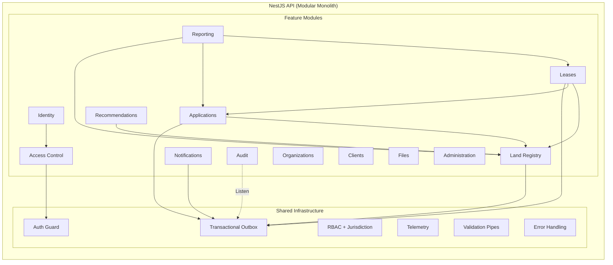
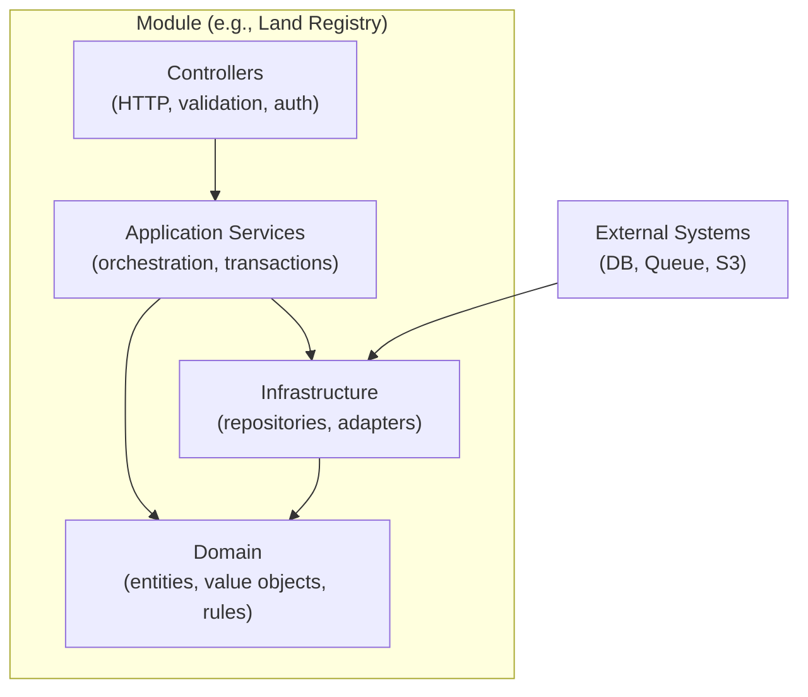
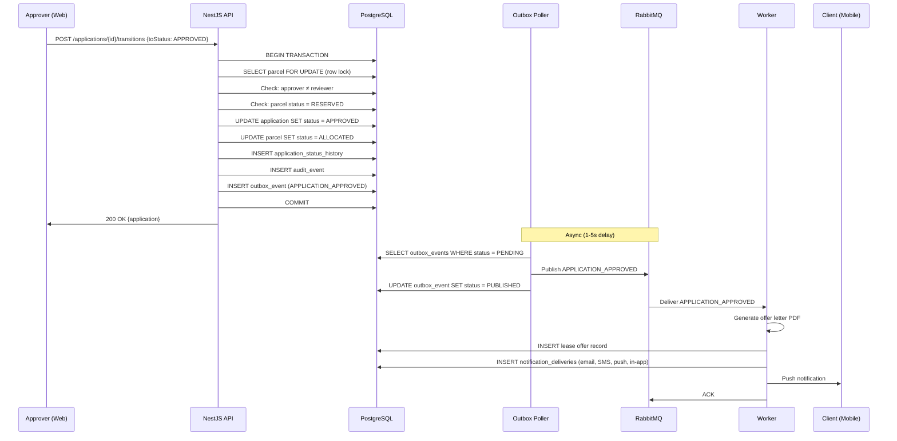
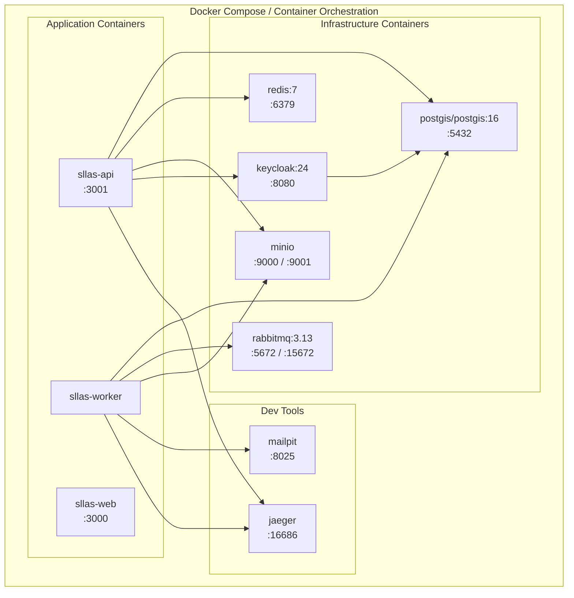

# SLLAS Architecture Overview

## System Architecture

```mermaid
graph TB
    subgraph Clients["Client Applications"]
        WEB["Web App<br/>(Next.js + React)"]
        MOB["Mobile App<br/>(React Native + Expo)"]
    end

    subgraph Gateway["API Layer"]
        API["NestJS API<br/>(Modular Monolith)"]
    end

    subgraph Auth["Identity"]
        KC["Keycloak<br/>(OIDC / OAuth 2.0)"]
    end

    subgraph Data["Data Layer"]
        PG["PostgreSQL + PostGIS"]
        RD["Redis<br/>(Cache + Rate Limit)"]
        S3["MinIO / S3<br/>(Files)"]
    end

    subgraph Async["Async Processing"]
        RMQ["RabbitMQ"]
        WKR["Worker Process"]
    end

    subgraph Observe["Observability"]
        OTEL["OpenTelemetry"]
        JAEG["Jaeger / Logs"]
    end

    WEB -->|HTTP-only Cookies| API
    MOB -->|Bearer JWT (PKCE)| API
    WEB -->|OIDC Login| KC
    MOB -->|PKCE Flow| KC
    API -->|Validate JWT| KC
    API -->|SQL + PostGIS| PG
    API -->|Cache / Throttle| RD
    API -->|Signed URLs| S3
    API -->|Outbox Events| PG
    WKR -->|Poll Outbox| PG
    WKR -->|Publish| RMQ
    WKR -->|Consume| RMQ
    WKR -->|Send Notifications| SMTP["Email / SMS"]
    WKR -->|Generate PDFs| PDF["PDF Engine"]
    API -->|Traces| OTEL
    WKR -->|Traces| OTEL
    OTEL --> JAEG
```

## API Module Architecture



## Module Layers (Each Module)



## Data Flow: Application Approval



## Deployment Architecture (Docker)


