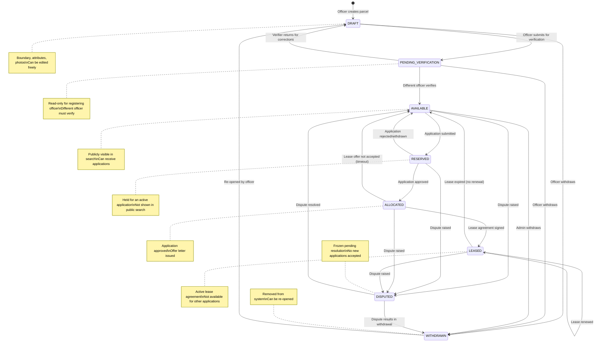
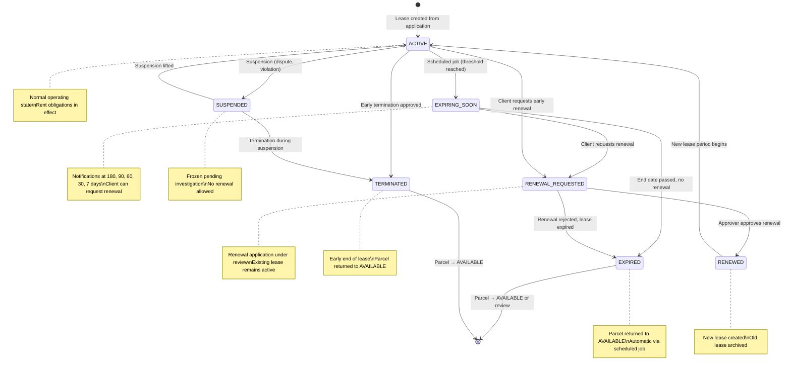
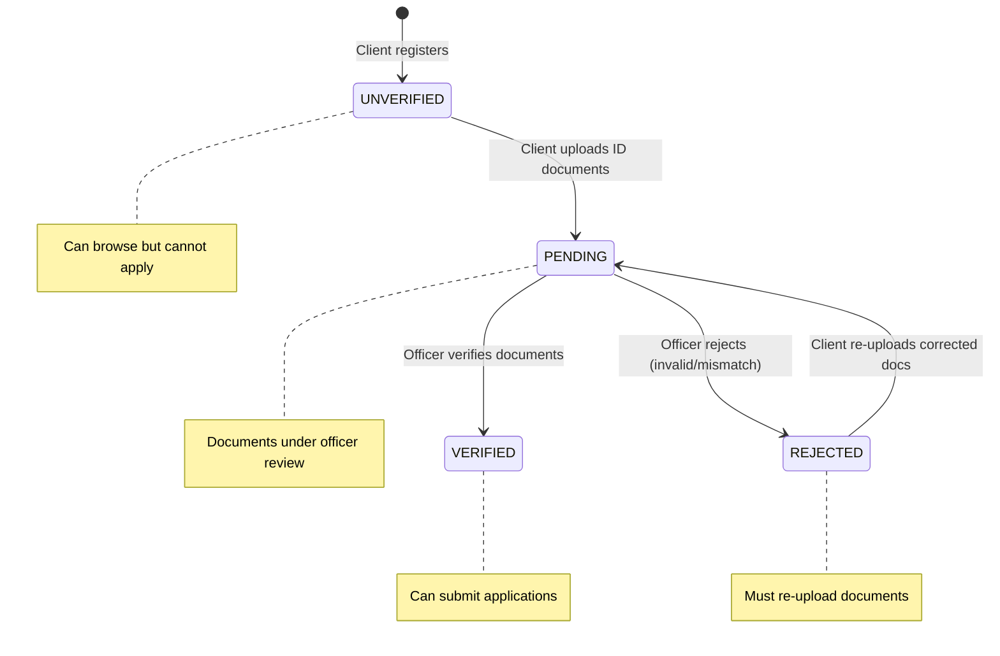
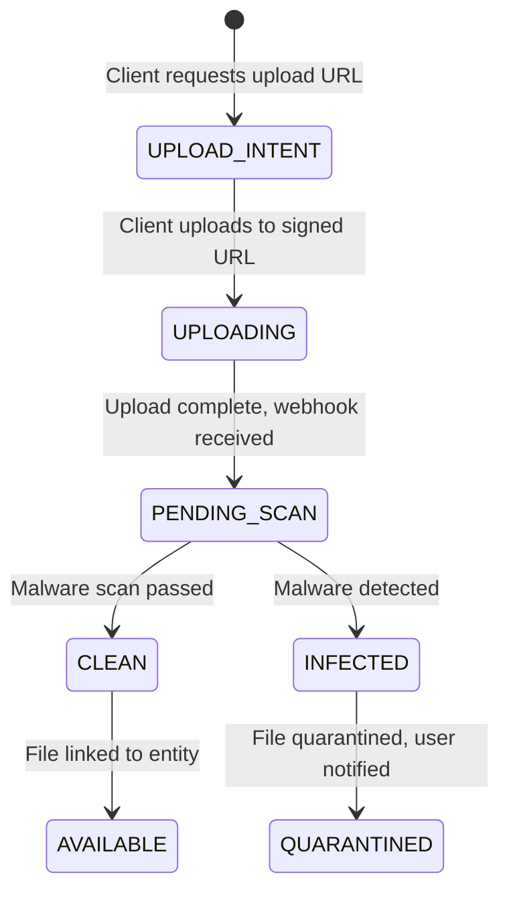

# SLLAS State Machine Diagrams

## 1. Land Parcel Status



### Parcel Status Transition Rules

| From | To | Allowed Roles | Conditions |
|------|-----|---------------|------------|
| — | DRAFT | Registry Officer | New parcel registration |
| DRAFT | PENDING_VERIFICATION | Registry Officer | All required fields filled, boundary valid |
| PENDING_VERIFICATION | AVAILABLE | Registry Officer | Different officer from registerer, no overlaps |
| PENDING_VERIFICATION | DRAFT | Registry Officer | Verifier can return with notes |
| AVAILABLE | RESERVED | System | Triggered when application is submitted for this parcel |
| RESERVED | ALLOCATED | System | Triggered when application is approved |
| RESERVED | AVAILABLE | System | Triggered when application is rejected or withdrawn |
| ALLOCATED | LEASED | System | Triggered when lease agreement is signed |
| ALLOCATED | AVAILABLE | System | Offer timeout or not accepted |
| LEASED | AVAILABLE | System | Lease expired, scheduled job |
| Any | WITHDRAWN | Registry Officer, Admin | Manual withdrawal with reason |
| Any | DISPUTED | Registry Officer, Admin | Dispute raised with documentation |
| WITHDRAWN | DRAFT | Registry Officer | Re-open for editing |
| DISPUTED | AVAILABLE / WITHDRAWN | Admin | Dispute resolution |

---

## 2. Lease Application Status

```mermaid
stateDiagram-v2
    [*] --> DRAFT : Client starts application

    DRAFT --> SUBMITTED : Client submits
    DRAFT --> WITHDRAWN : Client withdraws

    SUBMITTED --> UNDER_REVIEW : Officer picks up
    SUBMITTED --> WITHDRAWN : Client withdraws

    UNDER_REVIEW --> INFO_REQUESTED : Officer requests more info
    UNDER_REVIEW --> SITE_INSPECTION : Officer schedules inspection
    UNDER_REVIEW --> APPROVED : Approver approves
    UNDER_REVIEW --> REJECTED : Approver rejects
    UNDER_REVIEW --> WITHDRAWN : Client withdraws

    INFO_REQUESTED --> UNDER_REVIEW : Client provides info
    INFO_REQUESTED --> WITHDRAWN : Client withdraws

    SITE_INSPECTION --> UNDER_REVIEW : Inspection complete
    SITE_INSPECTION --> WITHDRAWN : Client withdraws

    APPROVED --> OFFER_ISSUED : System generates offer letter
    APPROVED --> WITHDRAWN : Admin withdraws (exceptional)

    OFFER_ISSUED --> ACCEPTED : Client accepts offer
    OFFER_ISSUED --> REJECTED : Client declines / offer expires
    OFFER_ISSUED --> WITHDRAWN : Admin withdraws (exceptional)

    ACCEPTED --> AGREEMENT_SIGNED : Signed agreement uploaded
    ACCEPTED --> WITHDRAWN : Client withdraws

    AGREEMENT_SIGNED --> ACTIVE : Lease record created

    REJECTED --> [*]
    WITHDRAWN --> [*]
    ACTIVE --> [*]

    note right of DRAFT : Client can save partial\napplication and resume later
    note right of SUBMITTED : Assigned to officer\nSLA timer starts
    note right of UNDER_REVIEW : Officer reviews docs,\nparcel suitability
    note right of INFO_REQUESTED : Client notified,\nSLA paused
    note right of SITE_INSPECTION : Physical visit scheduled\nInspection report required
    note right of APPROVED : Segregation of duties:\nReviewer ≠ Approver
    note right of OFFER_ISSUED : PDF offer letter generated\nTime-limited acceptance
    note right of ACTIVE : Lease record created\nParcel status → LEASED
```

### Application Status Transition Rules

| From | To | Allowed Roles | Conditions |
|------|-----|---------------|------------|
| — | DRAFT | Client | Parcel must be AVAILABLE |
| DRAFT | SUBMITTED | Client | All required fields, documents, valid client profile |
| SUBMITTED | UNDER_REVIEW | Registry Officer | Officer assigned (auto or manual), same jurisdiction |
| UNDER_REVIEW | INFO_REQUESTED | Registry Officer | Specify what info is needed |
| INFO_REQUESTED | UNDER_REVIEW | Client | Upload/provide requested info |
| UNDER_REVIEW | SITE_INSPECTION | Registry Officer | Schedule date, assign inspector |
| SITE_INSPECTION | UNDER_REVIEW | Registry Officer | Inspection report filed |
| UNDER_REVIEW | APPROVED | Approver | Approver ≠ reviewing officer, within jurisdiction |
| UNDER_REVIEW | REJECTED | Approver | Reason required |
| APPROVED | OFFER_ISSUED | System | PDF generated and sent to client |
| OFFER_ISSUED | ACCEPTED | Client | Within acceptance deadline |
| OFFER_ISSUED | REJECTED | System/Admin | Deadline expired or client declines |
| ACCEPTED | AGREEMENT_SIGNED | Client/Officer | Signed document uploaded |
| AGREEMENT_SIGNED | ACTIVE | System | Lease record created, parcel → LEASED |
| Any (except ACTIVE) | WITHDRAWN | Client/Admin | Reason logged |

### Segregation of Duties

The system enforces that `application.assigned_officer_id ≠ application.assigned_approver_id`. The approval endpoint checks this at the service layer and returns `403 Forbidden` if the same user attempts both review and approval.

---

## 3. Lease Lifecycle



### Lease Expiry Notification Schedule (Configurable)

| Days Before Expiry | Notification Type | Channels |
|-------------------|-------------------|----------|
| 180 | Early reminder | In-app, Email |
| 90 | Renewal reminder | In-app, Email, SMS |
| 60 | Urgent reminder | In-app, Email, SMS, Push |
| 30 | Final warning | All channels |
| 7 | Last chance | All channels |
| 0 | Expired | All channels |

### Lease Status Transition Rules

| From | To | Trigger | Conditions |
|------|-----|---------|------------|
| — | ACTIVE | System | Application reaches ACTIVE, lease created |
| ACTIVE | EXPIRING_SOON | Scheduled Job | Days to expiry ≤ first threshold |
| ACTIVE/EXPIRING_SOON | RENEWAL_REQUESTED | Client | Renewal request submitted |
| RENEWAL_REQUESTED | RENEWED | Approver | New lease period, terms accepted |
| RENEWAL_REQUESTED | EXPIRED | Approver/System | Renewal rejected + lease expired |
| EXPIRING_SOON | EXPIRED | Scheduled Job | End date passed |
| ACTIVE | TERMINATED | Approver | Early termination approved |
| ACTIVE | SUSPENDED | Admin/Approver | Cause documented |
| SUSPENDED | ACTIVE | Admin/Approver | Suspension lifted |
| SUSPENDED | TERMINATED | Admin/Approver | Termination during suspension |
| EXPIRED/TERMINATED | — | System | Parcel status → AVAILABLE (or review) |

---

## 4. Client Profile Verification



---

## 5. File Upload & Scanning


